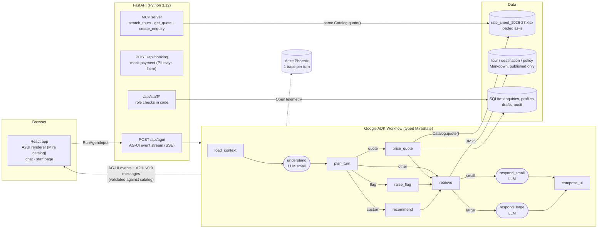

# Mira – AI travel booking assistant for Ceylon Compass Holidays

Mira chats with a traveller, works out the trip and who is travelling, generates its own interface
(A2UI), quotes prices that come only from a deterministic pricing function, and saves every quote as
a private enquiry for staff. Each traveller turn is one trace in Arize Phoenix, and an automated
evaluation suite shows how well it works.

> Take-home for Alt SourceCode, 19–25 November 2026. Ceylon Compass and all prices are fictional.

---

## 1. Run it

**Prerequisites:** Docker Desktop and a Gemini API key.

```bash
cp .env.example .env        # then set GOOGLE_API_KEY in .env
```

```bash
docker compose up --build
```

| What | URL |
|---|---|
| Mira (traveller chat) | http://localhost:8080 |
| Staff page (enquiries, approvals, data issues, pricing rules) | http://localhost:8080/staff |
| Phoenix traces | http://localhost:6006 |
| API health | http://localhost:8000/api/health |

Demo staff accounts are on the staff sign-in screen: **Nimal (Sales agent)** and **Ayesha (Content approver)**.

**Mock payment cards:** any card number works, except numbers ending in `0002` (payment declined) and `0003` (booking system down). Both failure cards show a friendly message with a way forward.

### Local understanding (fewer Gemini calls)

Each message is first read by `mira/nlu`: rules extract the tour, party, children's ages, dates and places, and a small
TF-IDF + logistic-regression classifier picks the intent. Gemini's `understand` agent is only called when the classifier is
unsure, the intent needs free-text reading (custom trips, services, vague requests), or a slot is ambiguous (e.g. "next month",
"the kids", "the second one"). Retrain with `cd backend && uv run python -m mira.nlu.train`; turn it off with `MIRA_LOCAL_NLU=0`.

### Tests and evaluations

```bash
cd backend && uv run pytest                                      # 48 unit tests (pricing, guards, MCP)
```

```bash
cd backend && uv run python ../evals/run_evals.py                # full eval suite -> evals/reports/latest.md
```

```bash
docker compose exec api uv run python ../evals/run_evals.py      # same, inside the running container
```

Useful options: `--only S02,M03`, `--requirement R5`, `--judge-agreement`, `--no-judge`.

### Without Docker (development)

```bash
docker run -d -p 6006:6006 -e PHOENIX_ENABLE_AUTH=false arizephoenix/phoenix:version-22.0.0
```

```bash
cd backend && uv sync && uv run uvicorn mira.api.server:app --port 8000 --reload
```

```bash
cd frontend && npm install && npm run dev                        # http://localhost:5173
```

### Settings (`.env`)

| Variable | Default | Purpose |
|---|---|---|
| `MIRA_TODAY` | `2026-11-19` | "Today" for pricing, deposits and expiry. Eval expectations assume 19 Nov 2026. |
| `MIRA_MODEL_SMALL` | `gemini-3.1-flash-lite` | Simple turns: understanding, greetings, quotes, flags, refusals |
| `MIRA_MODEL_LARGE` | `gemini-3-flash-preview` | Free-text grounded answers, multi-day and custom planning, content drafting |
| `MIRA_MODEL_FALLBACK` | `gemini-2.5-flash` | Used automatically if the routed model errors (503/504) or its daily quota is used up |
| `MIRA_RPM` | see `mira/ratelimit.py` | Per-model requests-per-minute limits, e.g. `gemini-3.1-flash-lite=14` |
| `MIRA_MODEL_JUDGE` | `gemini-2.5-flash` | LLM judge in the eval suite |
| `MIRA_GROUNDING_FIX` | `1` | `0` reproduces the behaviour before the fix described in §6 |

---

## 2. Architecture



Rounded nodes call the LLM; square nodes are plain Python. **Pricing, permissions, publishing,
UI validation and the price guard are code, never prompt instructions.**

### One traveller turn

1. **API boundary.** `/api/agui` receives an AG-UI `RunAgentInput`. The text is scrubbed of e-mails, phone and card numbers and "my name is …" before it reaches the agent, the session or a trace. UI clicks arrive as structured actions (`get_quote`, `set_travellers`, …).
2. **`load_context`** restores a returning visitor's saved trip and last quote (no personal data is stored, just party make-up and dates).
3. **`understand`** (small model, structured output) classifies the intent and extracts slots: tour ID (only from the published catalog), adults, child ages, start date, destinations and so on.
4. **`plan_turn`** is pure code. It validates and merges the slots, runs a regex injection check alongside the model's own judgement, and picks a route (`quote`, `flag`, `custom`, `ask`, `answer`, `refuse`, `greet`, `booking`) and a model route (small or large).
5. **`price_quote`** calls `Catalog.quote()`. The result is either a `Quote` (saved as an enquiry with cost, price, GP% and the trace ID) or `NeedsSpecialist` (saved as a staff flag with reason codes). There is no third outcome.
6. **`retrieve`** runs BM25 over *published* chunks only. Testimonials are excluded unless the traveller asks for reviews.
7. **`respond_small` / `respond_large`** write the reply and choose UI components from a fixed list. They never see costs and are told not to write money figures.
8. **`compose_ui`** removes any sentence containing a money amount (the price guard). It then builds the A2UI messages from deterministic data: prices are *data-model bindings* filled from the stored quote. It validates the payload against the catalog, falls back to plain text if validation fails, and saves the visitor's memory.

### Generative UI (A2UI v0.9 over AG-UI)

The catalog `https://ceyloncompass.example/a2ui/catalogs/mira/v1.json` (`backend/mira/ui/catalog.py`, served at `/api/a2ui/catalog`) has 12 components. The core five are **TravellerPicker, TourCard, ItineraryDay, PriceBreakdown and BookingForm**. The others are SpecialistHandoff, EnquiryForm, SourceList, QuickReplies, Notice, Text and Column.

- The LLM only picks components (for example `{"component": "TourCard", "tour_id": "T09"}`). Code fills every fact from content and every amount from the stored quote.
- `validate_messages()` rejects:
  - unknown components and unknown properties;
  - any literal money text anywhere in the payload;
  - a `PriceBreakdown` whose amounts are not bindings to `/quotes/<ref>/…`;
  - any data-model price that differs from the pricing function's result for that enquiry.
- The browser renderer (`frontend/src/a2ui/`) checks the catalog ID and component names again, so nothing outside the catalog can render.
- A2UI messages travel in AG-UI `CUSTOM` events named `a2ui`. Text arrives as `TEXT_MESSAGE_*` events, and progress as `STEP_*` events.
- Styling comes from `brand/brand_pack.json`: `frontend/src/brand.ts` fetches it from `/api/brand` and applies its colours, Inter font, type scale, radii and card width as CSS variables (the CSS defaults match it, so nothing flashes). The layout works on mobile and desktop. There are light and dark themes: the theme follows the system setting, and the moon/sun button in the header overrides it. Cards stay white in both themes, as the brand pack says. Dark-mode colours other than the brand-pack values are my own derivation; every text pair passes WCAG AA.
- **Voice chat** (`frontend/src/chat/voice.ts`): the mic button in the input turns speech into text with the browser's Web Speech API, and that text is sent exactly like typed text, so it goes through the same scrubbing, pricing and UI validation. The speaker button makes Mira read her replies aloud. If you start with the mic, the conversation is hands-free: Mira answers aloud and then listens again until you tap the mic or stay silent. Mira's spoken price is read from the quote bound into the PriceBreakdown card, never from model text. No audio reaches our backend.
- The home page's tour grid never shows prices. The tour pages' "from" prices disagree with the rate workbook, so a price only ever appears as a quote in the chat.

---

## 3. Pricing (requirement 5)

`backend/mira/pricing/engine.py` implements the 11 rules on the workbook's READ ME tab, using exact
`Fraction` arithmetic until the two explicit rounding steps: round the total up to the next USD 5,
and round the deposit up to a whole USD.

- Vehicle by group size (adults + children 2–11; infants have no seat).
- Rooms: adults share doubles, an odd adult takes a single, and each child 2–11 gets an extra bed every night.
- Children 2–11 pay the child entrance fee and 50% of adult meals. Infants under 2 are free. A "child" aged 12+ pays adult rates.
- The hotel rate is chosen per night (night 1 = start date) by validity dates.
- `Sell = Cost ÷ (1 − margin)`, with the day-tour or multi-day margin. GP% is stored for staff.
- Deposit: day tours pay in full. Multi-day tours pay 25%, or the full amount if the start is ≤ 30 days away (≤ is my reading of "within 30 days"). The balance is due 30 days before the start.
- Margins can be overridden live in `config/pricing_rules.json`, or on the staff page by an Approver. The workbook itself is never edited.

`Catalog.quote()` adds checks that need the content too: the tour must be published, the offer must not be stale, and the page and workbook must agree on the duration.

**All 6 expected prices in the eval seed and the sample quotes reproduce exactly.** See `backend/tests/test_pricing.py` (30 tests, each with the hand calculation in a comment).

### Data problems found and how they are handled

The dataset is used unchanged. The loaders record each problem, and the staff page shows them under *Data issues*.

| Problem | Where | Handling |
|---|---|---|
| Number stored as text `"LKR 28,000"` | Hotels F8, F10 (Sigiriya Village) | Parsed to 28,000; logged |
| Date stored as text `"15/12/2026"` | Hotels D33 (Galle Fort Hotel) | Parsed day-first; logged |
| Cinnamon Wild Yala rates in **USD** | Hotels H10 rows | Converted at the fixed 300 LKR/USD; logged |
| Two overlapping Peak rows for Hotel Suisse ("Revised per supplier email?") | Hotels rows 13 and 56 | Nights in the overlap → **specialist flag** (user decision) |
| No single-room rate | Heritance Tea Factory | Odd-adult bookings on Treasures → specialist flag (S04) |
| Mirissa Bay Villas rates end Oct 2026 | Hotels H07 | Beach stay → specialist flag (S05) |
| Tour ID `T-13` vs `T13` in content | Tours A13 | Normalised; logged |
| Rates and FX only fixed until 31 Oct 2027 | Settings | Trips ending later → specialist flag |
| No rates at all | T10 Instafamous, T16 Cultural Triangle 5-night, airport transfers | Specialist flag (S06, S11) |
| Page says "1 night / 2 days"; workbook prices 1 day | T06 Kandy–Nuwara Eliya train tour | Specialist flag (user decision) |
| 2023/24 early-bird stay still published | T14 | Promotion line removed, no quote, flag (user decision) |
| Draft tour (Jaffna); workbook says "not launched" | T15 | Never indexed, never quoted |
| Hidden HTML comment telling the AI to give 40% off | `destinations/mirissa.md` | Stripped before indexing; logged |
| Testimonial addressed to "Mira" | `policies/testimonials.md` | Line removed; testimonials not used as facts |
| "Kids under 12 stay free" | T07 page (2024) | Removed; the Children policy (P03) says it replaces old offers |
| "Free cancellation up to 24 hours" | T04 page (2025) | Removed; the Cancellation policy (P02, 48 h) replaces older terms |
| Teaser prices ("From USD 85 per person") | Most tour pages | Never shown: they are not from the rate workbook and disagree with it |
| Sample quote Q-1043 says USD 2,680 | `rates/sample_quotes.md` | It omits the children's extra beds (64,000 LKR). The correct price is USD 2,965, which matches eval S03 |
| README says 15 starter cases | dataset README | The file and the brief have 17; all 17 are used |

---

## 4. Requirements → where they live

| # | Requirement | Implementation |
|---|---|---|
| 1 | Discover the trip in ≤ 3 questions | `understand` + `plan_turn`. One question per turn, a TravellerPicker for party, dates and trip type in one step, and tour suggestions as soon as anything is known |
| 2 | Returning visitors | Random visitor ID in `localStorage`; `visitors` table keeps trip slots and last quote (no PII). Greeting shows the last quote; known slots are not asked again |
| 3 | Generated interface | A2UI catalog + validator (§2) |
| 4 | Answer from content only | BM25 over published, cleaned content; grounding rule; cited sources; "I don't have that – shall I ask our team?" |
| 5 | Correct prices | §3; prices are bound from the stored quote, and a price guard strips money from model text |
| 6 | Missing or expired rates | `NeedsSpecialist` with reason codes → SpecialistHandoff + staff flag |
| 7 | Private enquiries | Every quote and flag goes into `enquiries` (cost, price, GP%, trace ID). The staff page has notes, status and trace links |
| 8 | Approve AI-written content | `content_drafter` agent → draft. `publish_content` permission (Approver only) is checked in code. Drafts are never indexed; publishing reloads the index |
| – | Mock booking and payment | `/api/booking`: personal details go straight to the enquiry row, never to the LLM or traces. Failures are friendly messages with next steps |
| Bonus | MCP server | `backend/mira/mcp_server.py`. Same `Catalog.quote()` and enquiry table |
| Bonus | Model routing | Small vs large by route, with a fallback model on errors. The eval report has pass rates per route |

---

## 5. Tracing (Arize Phoenix)

- One root span `mira.turn` per traveller turn. Under it are the ADK agent and LLM spans (OpenInference instrumentation) and Mira's own spans: `plan_turn`, `pricing.price_tour` (inputs, price, cost, GP, flag codes), `retrieval.search` (query and retrieved chunks), `recommend.rank_tours` and `ui.compose_and_validate` (components, validity, whether the price guard fired).
- Every saved quote stores its `trace_id`. The staff page links to `http://localhost:6006/redirects/traces/<trace_id>`.
- Personal data: chat text is scrubbed at the API boundary, and a span processor scrubs string attributes again before export. Booking and enquiry contact details never pass through a traced code path.

---

## 6. Evaluation

`evals/run_evals.py` runs **54 cases**: the 17 seed cases (unchanged, read from the dataset), 33 of
mine in `evals/cases/mira_cases.jsonl`, and 4 API-level cases. At least 7 are multi-turn.

- **Code checks** run wherever there is an exact answer:
  - price and deposit equal the expected values *and* the pricing function's result for the saved request;
  - no money appears in model text;
  - every A2UI payload re-validates;
  - only published content is cited;
  - flags are raised with the right reason code;
  - quotes are saved with cost, GP% and trace ID;
  - personal data is scrubbed;
  - role checks hold.
- **LLM judge** (`evals/judge.py`) checks behaviour descriptions against the transcript and the retrieved documents.
- **Judge agreement** is measured against 10 cases labelled by hand: `--judge-agreement` → `evals/reports/judge_agreement.md`.
- **Report:** `evals/reports/latest.md` has the targets, pass rates per requirement and per model route, and the failing cases with trace links.

### Latest results ([`evals/reports/latest.md`](evals/reports/latest.md))

Run on 2026-11-20 with every role on `gemini-3.1-flash-lite`, because the free-tier daily caps on the other models were used up that day. That makes it a fair test of Mira's logic but not of the small/large routing.

| Target | Goal | Result |
|---|---|---|
| Price accuracy | 100% | **100%** (13/13 priced cases, every price also recomputed by the pricing function) |
| Invented prices | 0 | **0** |
| Missing / expired rates handled | 100% | **100%** (11/11: flag raised, specialist message, no price) |
| A2UI payload valid | 100% | **100%** (61/61 turns) |
| All cases | – | **53/54** |

The one failure (M33) is an LLM-judge false negative: it read "day-tour options **or** a traveller picker" as requiring both. The code checks for that case pass.

Judge agreement with my 10 hand labels: **10/10** ([`judge_agreement.md`](evals/reports/judge_agreement.md)). All 10 labels were "pass", so this does not yet test whether the judge catches failures; see the notes in that file.

Other limits on these numbers:
- **Requirement 2 rests on one case.** It is covered by a single multi-turn case (M17), plus API cases for enquiries and approvals.
- **Per-route figures are not meaningful yet.** The per-route table needs a run with the routed models; re-run it after the daily quota resets:

```bash
cd backend && uv run python ../evals/run_evals.py
```

### A real problem found through the evals

See [`evals/findings/`](evals/findings/). On the first end-to-end run, S09 ("Is Yala open in
September?") was answered "Yala National Park is open in September", a fact that appears nowhere in
our content. The fix had two parts:

1. A stricter grounding rule. Every factual sentence must be stated in FACTS; for opening times, seasons, visas and the like, say "I don't have that" and offer to ask the team.
2. Routing free-text factual answers to the larger model.

`MIRA_GROUNDING_FIX=0` reproduces the before state, so the before and after numbers come from the same suite.

---

## 7. Design decisions and trade-offs

- **ADK `Workflow` graph instead of one tool-calling agent.** The order of steps is fixed in code, so pricing always runs when it should and the LLM cannot skip it, and every step shows up in the trace. The cost is two LLM calls per turn, which takes 5–20 s on the current Gemini key.
- **A2UI messages from a small renderer we own.** The protocol is the real A2UI v0.9 message format. I didn't use `@a2ui/react` (v0.15) because its API was still changing week to week; a ~300-line renderer for 12 components is easier to explain and lock down.
- **BM25, not embeddings.** About 30 short pages; BM25 is deterministic, explainable in a trace and needs no second API. Embeddings would help with vaguer phrasing.
- **Prices never in model text.** Mira says "the price is shown below" and the PriceBreakdown card shows it from bound data. That gives up some fluency for a provable guarantee.
- **Conservative with ambiguous data.** Conflicting, missing, expired or inconsistent rates always go to a specialist (you made this call for H03, T06 and T14).
- **SQLite.** One file, zero setup for reviewers. A real deployment would use Postgres.

## 8. Known limitations

- **Gemini free tier.** The key has per-minute *and* per-day caps per model (for example `gemini-3.5-flash` allows only 20 requests a day). Mira paces calls per model, never waits on a daily cap, and switches to the fallback model. The eval report counts API outages as infrastructure errors, separate from failures, and `--resume` / `--rerun-errors` finish a run on another day. A paid key removes this limitation without code changes.
- Latency: two LLM calls per turn (typically 5–20 s). Streaming partial text would help.
- Staff sign-in uses demo tokens, not real authentication.
- Destination photos are openly licensed Wikimedia Commons images loaded from Wikimedia's CDN, credited in the site footer. Without internet they fall back to the original illustrations. Other illustrations (people, states) are original SVG written in code, not professional artwork; see `frontend/ATTRIBUTION.md`.
- Voice input needs Chrome, Edge or Safari (Firefox has no speech recognition, so the mic button is hidden there). In Chrome and Edge, the browser sends the audio to its own speech service. Spoken names, e-mails and card numbers are scrubbed like typed ones, but recognition errors in them are possible; the booking form should still be typed.
- The PII scrubber is pattern-based: it catches e-mails, phone and card numbers and "my name is …", but not every free-text name.
- The content agent can only reference text content. The dataset has no photos ("using the Ella photos" becomes an open question in the draft).
- The returning-visitor memory lives on one browser (a random ID in `localStorage`); there are no accounts.
- Personalisation (the third bonus) is not built.

## 9. AI tools used

- **Claude Code (Claude Opus 5.5)** wrote most of the code in this repository, step by step, under my direction and review: backend, frontend, eval suite and this README. I reviewed each part and made the product decisions (stack, how to treat ambiguous rates, UI direction in `UI-DESIGN.md`).
- **Google Gemini** runs Mira, the content drafter and the LLM judge at runtime.
- **Images:** destination photos are from Wikimedia Commons (CC BY-SA / CC0, credited in the footer). All other artwork is hand-written SVG produced with Claude Code (no image model, no stock art). Each asset is listed in `frontend/ATTRIBUTION.md`.
- No third-party code is copied into the repository. Libraries are used through their package managers.
